# ha-timeline-card

[](https://www.home-assistant.io/integrations/marketplace/)
[](https://github.com/juju35/ha-timeline-card/actions/workflows/hacs.yml)
[](https://github.com/juju35/ha-timeline-card/actions/workflows/validate.yml)
[](https://github.com/juju35/ha-timeline-card/actions/workflows/lint.yml)
[](https://github.com/juju35/ha-timeline-card/releases/latest)
[](https://github.com/juju35/ha-timeline-card/blob/main/LICENSE)
[](https://buymeacoffee.com/julienstep9)

<p align="center"></p>

<p align="center">
  &nbsp;&nbsp;
  
</p>

A Lovelace card that shows **what happened at home today**: Home Assistant's logbook made readable, grouped by part of the day, with filter pills and repeats folded.

[](https://my.home-assistant.io/redirect/marketplace_repository/?owner=juju35&repository=ha-timeline-card&category=plugin)

| Card | Type | What it shows |
|---|---|---|
| [Timeline](#screenshots) | `custom:timeline-card` | Today's logbook grouped by part of the day, each entry in the colour of its state, with filter pills by kind. |
| [Timeline mini](#timeline-mini) | `custom:timeline-mini-card` | How many entries today and the last one, with a zoom to the full timeline. |

| Today | An alert |
|---|---|
| 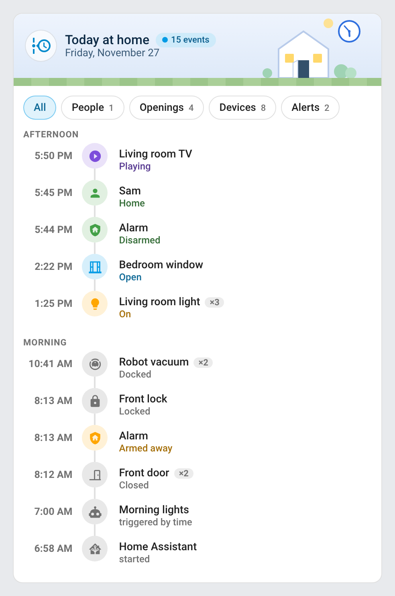 | 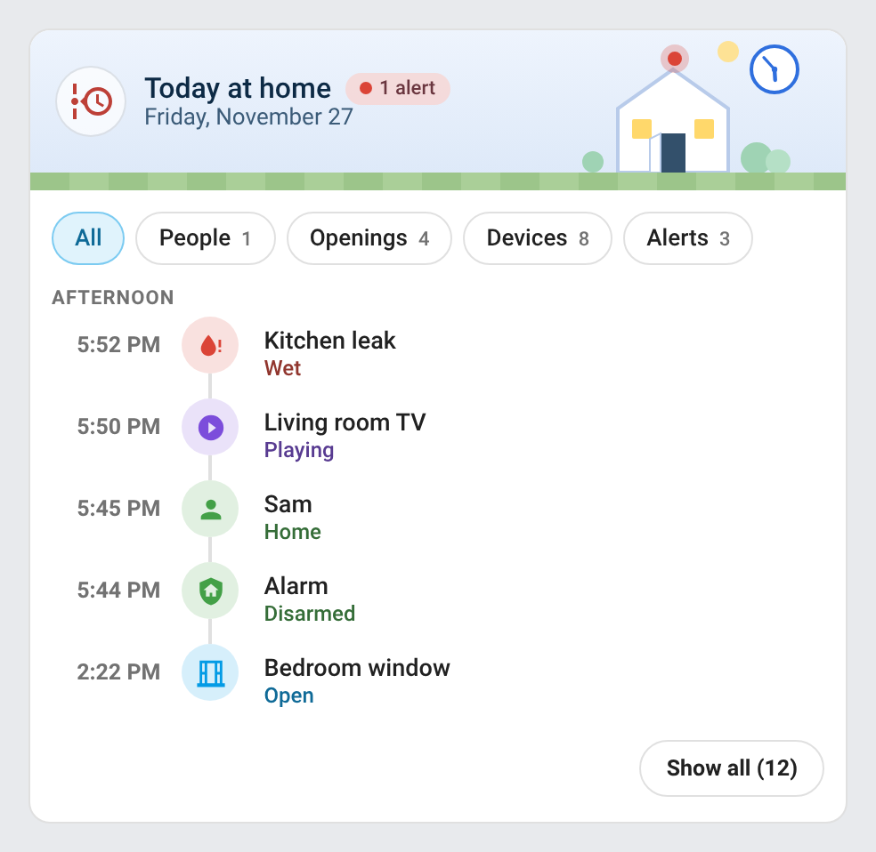 |

## Features

- **Grouped by part of the day**: night, morning, afternoon and evening, newest first, with the time of each entry
- **The colour of the state**: green at home or all clear, blue open (or in another zone), amber a device at work, violet a media playing, red an alert, grey at rest; an icon for each kind (door open or closed, window, lock, light, vacuum, alarm…)
- **Filter pills** by kind — *people*, *openings*, *devices*, *alerts* — shown only for the kinds that have entries, with their count
- **Repeats folded**: an entity changing several times in a row is one row with `×3`
- **The first rows, then *Show all***: `max_events` rows (12 by default), the rest one tap away
- **Your choice of entities**: only some (`entities`), or all but some (`exclude`, with patterns such as `sensor.*`)
- **Illustrated header**: a house whose clock shows the time; its windows light up for a recent entry (and by night), its door opens while an opening is open, and a red beacon pulses on the roof for an active alert; the dark theme brings the night
- **Mini card**: the title with the count (or the active alerts), then the last entry and how long ago; its zoom button opens the full timeline in place
- **Tap an entry** to open its entity's details
- **Light on the dashboard**: the logbook is read once the card is on screen, then every minute
- Visual editor for both cards, light and dark themes, 22 languages, no external dependency

## Supported integrations

The card reads Home Assistant's logbook, so it shows any entity the logbook records.

| | Integration | What the cards show |
|:---:|---|---|
|  | [Logbook](https://www.home-assistant.io/integrations/logbook/) (built in) | Every state change and event of the day |
|  | [Person](https://www.home-assistant.io/integrations/person/), [binary sensors](https://www.home-assistant.io/integrations/binary_sensor/), [locks](https://www.home-assistant.io/integrations/lock/), [alarm panels](https://www.home-assistant.io/integrations/alarm_control_panel/) (built in) | People coming and going, doors and windows, leaks and smoke, the alarm |

## Installation

### Via the Marketplace (recommended)

Click the button below to add the repository directly:

[](https://my.home-assistant.io/redirect/marketplace_repository/?owner=juju35&repository=ha-timeline-card&category=plugin)

Or manually:

1. Open **Settings → Marketplace → Add from link** (top right; this needs a GitHub account connected)
2. Add `https://github.com/juju35/ha-timeline-card` — Type: **Dashboard**
3. Open **Timeline Card** and click **Install**
4. Clear your browser cache and refresh

The Marketplace registers the dashboard resource for you.

### Manual

1. Download `ha-timeline-card.js` and the `ha-timeline-card.i18n.*.js` translation files from the [latest release](https://github.com/juju35/ha-timeline-card/releases/latest)
2. Copy them all to `/config/www/` (without the translation files, the cards show in English)
3. Go to **Settings → Dashboards → Resources** → Add resource:
   - URL: `/local/ha-timeline-card.js`
   - Type: **JavaScript Module**
4. Clear your browser cache and refresh

## Configuration

Every option is in the visual editor; the patterns of `exclude` (`sensor.*`) are written in YAML. In YAML:

```yaml
# Everything the logbook recorded today
type: custom:timeline-card

# A few entities over the last 24 hours, the first 8 rows
type: custom:timeline-card
entities:
  - person.sam
  - binary_sensor.front_door
  - lock.front
  - alarm_control_panel.home
hours_to_show: 24
max_events: 8

# All but the noisy ones
type: custom:timeline-card
exclude:
  - sensor.*
  - automation.*
  - light.hallway

# Two lines on a phone dashboard
type: custom:timeline-mini-card
```

| Option | Type | Default | Description |
|---|---|---|---|
| `title` | string | `Today at home` | Both: card title (`Last N hours` with `hours_to_show`) |
| `show_title` | boolean | `true` | Both: show the title |
| `show_subtitle` | boolean | `true` | Both: today's date under the title |
| `navigation_path` | string | | Both: a tap on the header opens this dashboard path |
| `entities` | list | the whole logbook | Both: only these entities |
| `exclude` | list | | Both: entities left out; in YAML, patterns with `*` such as `sensor.*` or `*_battery` |
| `hours_to_show` | number | since midnight | Both: the last N hours instead (1 to 168) |
| `max_events` | number | `12` | Both: rows shown before the *Show all* button |
| `fold` | boolean | `true` | Both: one row when an entity changes several times in a row |
| `show_filters` | boolean | `true` | Both: the filter pills |
| `illustration` | boolean | `true` | Both: the illustrated header (`false`: the classic header) |
| `illustration_theme` | string | `auto` | Both: `auto` (follows the Home Assistant theme: night with a dark theme, day with a light theme), `day` or `night` |
| `zoom` | boolean | `true` | Mini card: the zoom button |
| `language` | string | Home Assistant's | Advanced: one of the [languages](#translations) |

## Screenshots

| Today | Openings only | Show all |
|---|---|---|
|  | 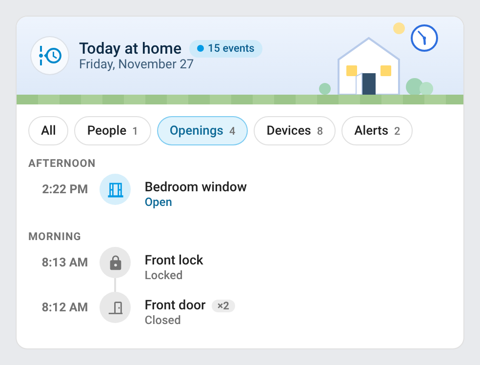 | 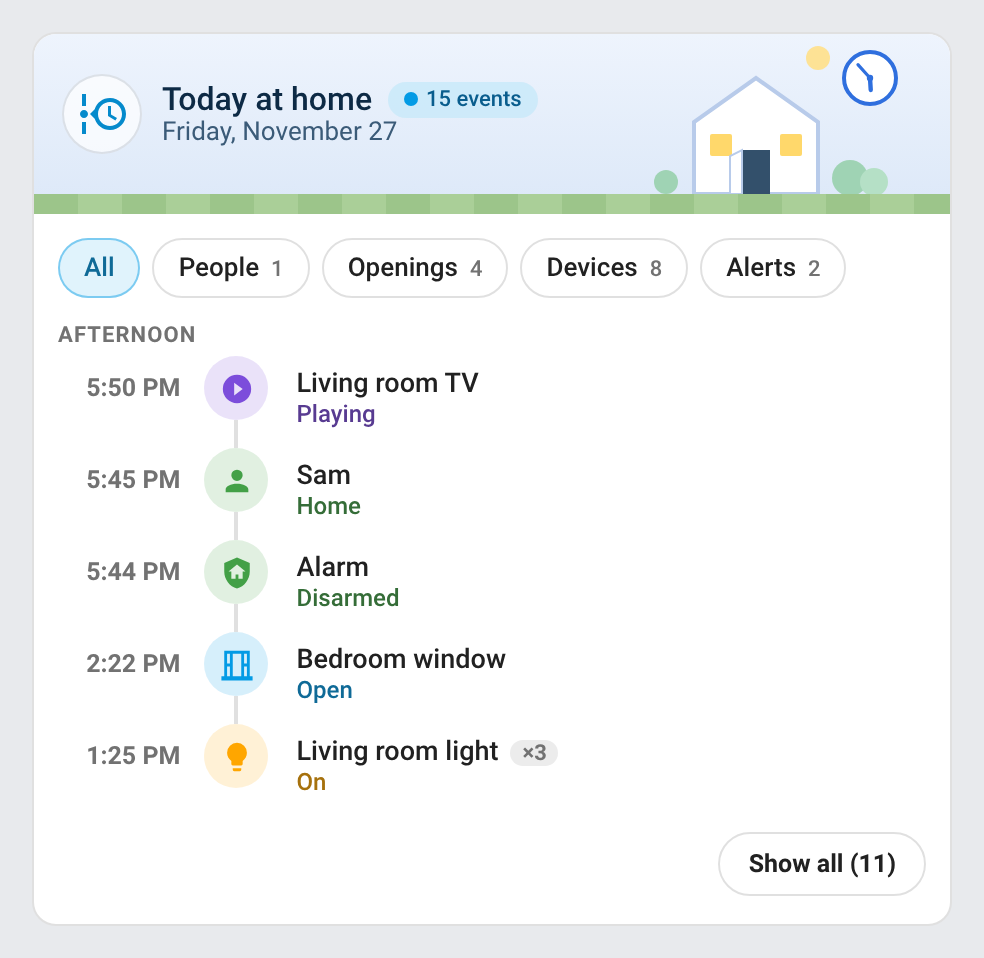 |
| 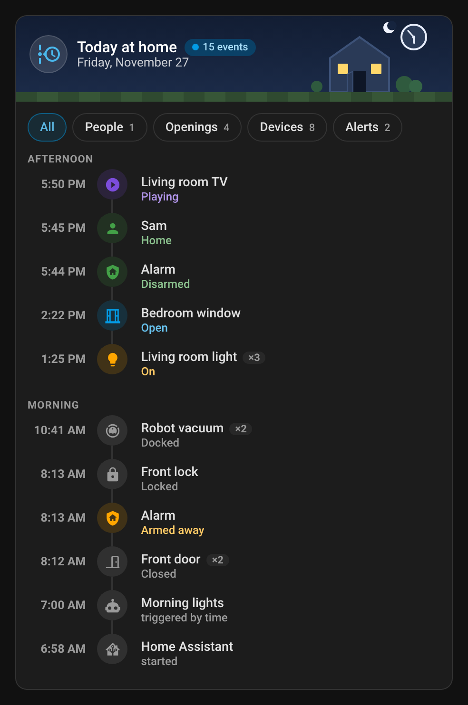 | 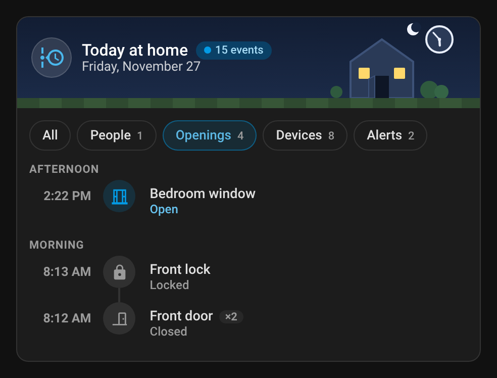 | 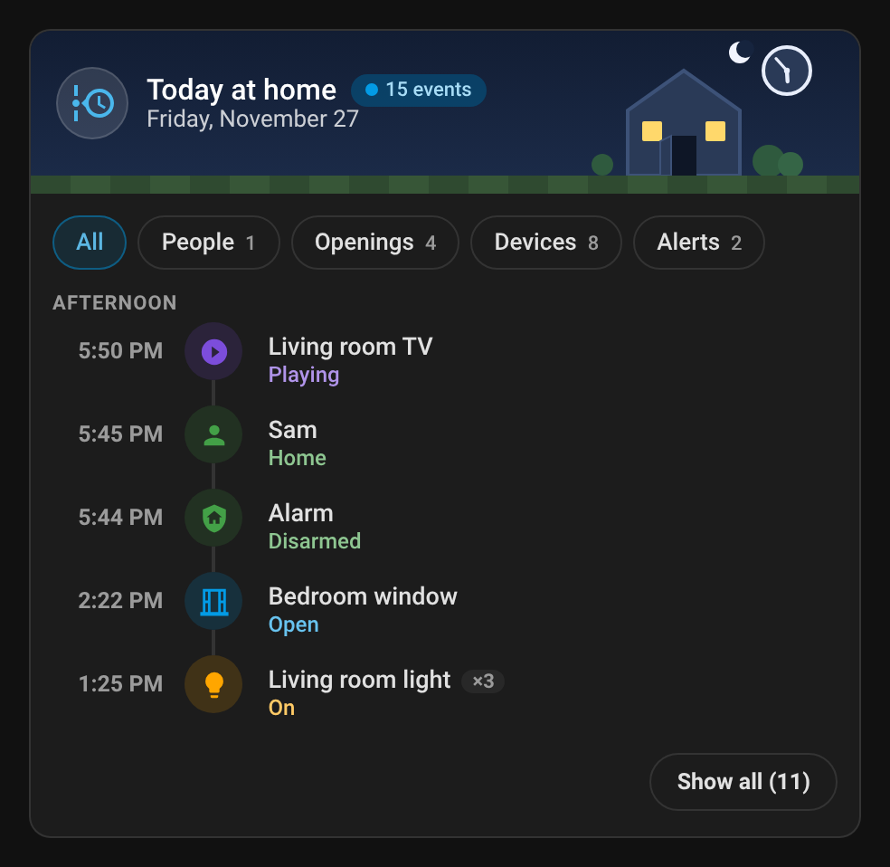 |

| An alert | Nothing yet | Narrow |
|---|---|---|
|  | 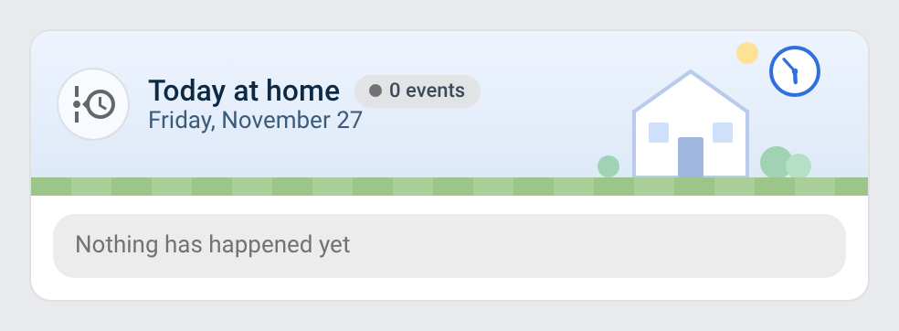 | 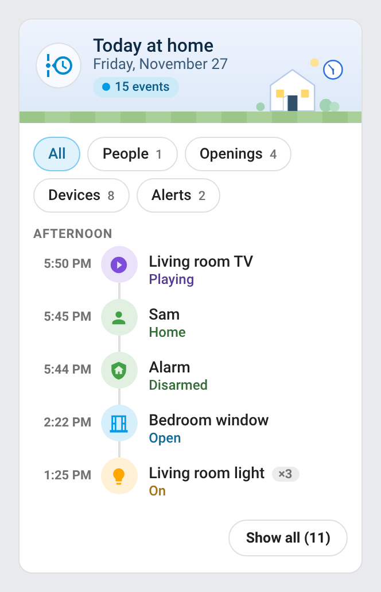 |
| 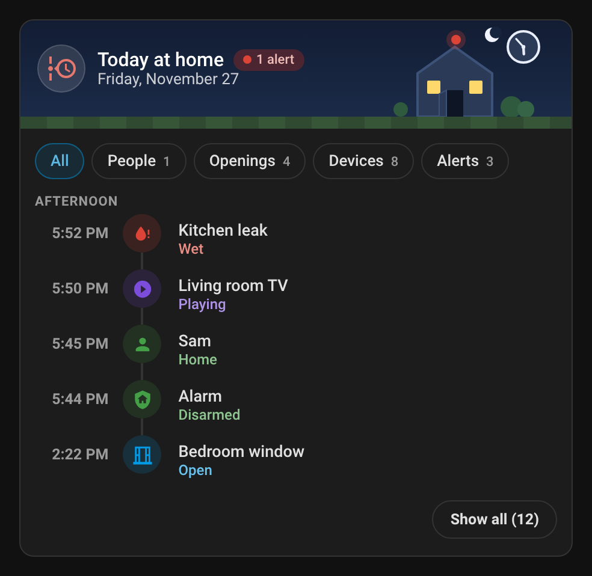 | 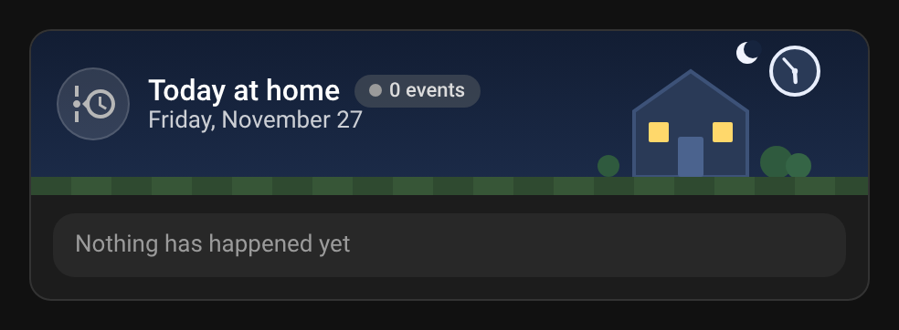 | 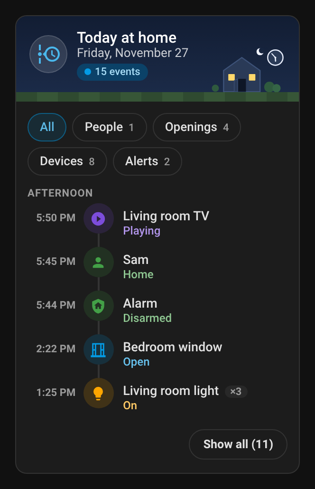 |

**Alert animation**: while an alert is active, the header's badge and the beacon on the roof pulse.

| Light | Dark |
|---|---|
|  | 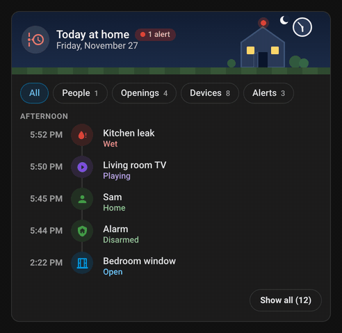 |

### Timeline mini

| Today | An alert | Zoomed in |
|---|---|---|
| 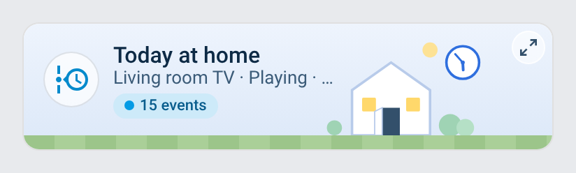 | 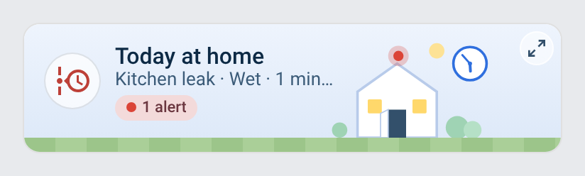 | 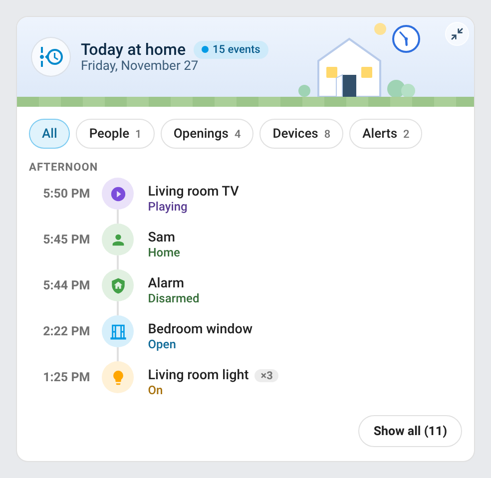 |
| 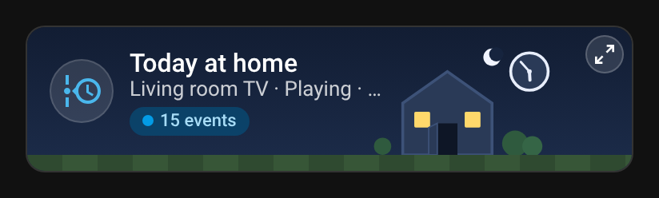 | 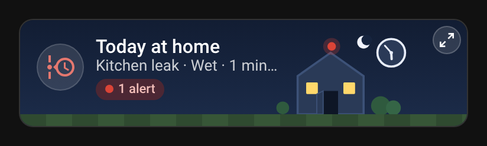 | 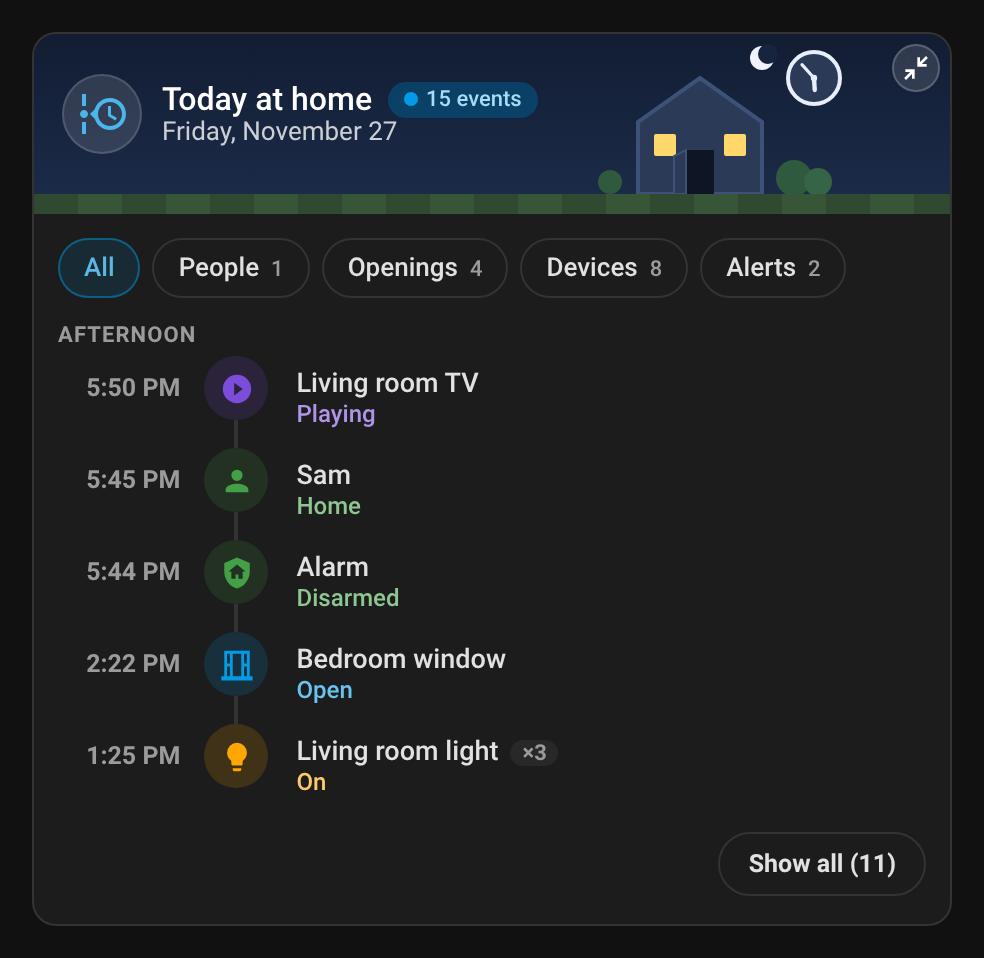 |

## How it works

- **Logbook**: read through Home Assistant's WebSocket (`logbook/get_events`, or the REST API when there is no WebSocket) from local midnight, or from `hours_to_show` hours ago, to now; once the card is on screen, then every minute
- **Kinds**: `person` and `device_tracker` are *people*; doors, windows, garage doors, `lock` and `cover` are *openings*; smoke, CO, gas, leak, safety, problem and tamper sensors, `alarm_control_panel` and `siren` are *alerts*; the rest are *devices*
- **Text**: the entity's name, then Home Assistant's own wording of the state (or the logbook's message, such as *triggered by time*)
- **Folding**: consecutive changes of the same entity within the same part of the day; the row shows the latest state
- **Status pill**: the active alerts (an alert entity whose current state is an alert) in red, else how many entries
- **Read only**: the card calls no action

## Development

```bash
npm install
npm run build        # stamps the version of package.json into dist/ha-timeline-card.js
npm run check        # builds and checks the bundle (run in CI)
npm test             # unit tests
npm run screenshots  # renders the cards with a mock logbook into screenshots/ (and the GIFs, needs ffmpeg)
```

The source is split into ES modules under `src/shared/` (entry `src/shared/index.js`); `npm run build` assembles them (`scripts/bundle.mjs`) into the single file the Marketplace serves.

`dist/` is not committed: `npm run build` creates it locally, CI builds it on every push, and the release workflow attaches the built files to the release, which is where the Marketplace installs them from.

### Releasing

1. Bump `version` in `package.json`
2. Add a `## <version>` section at the top of [CHANGELOG.md](https://github.com/juju35/ha-timeline-card/blob/main/CHANGELOG.md)
3. Merge a `feat` or `fix` pull request into `main`: the **Release** workflow builds the card, creates the tag and the GitHub release with the changelog section as notes, and attaches `ha-timeline-card.js` and its translation files

## Translations

The card auto-detects the language from your Home Assistant settings. Currently supported:

| Language | Code |
|---|---|
| English | `en` |
| Français | `fr` |
| Deutsch | `de` |
| Español | `es` |
| Српски | `sr` |
| Srpski (latinica) | `sr-Latn` |
| Italiano | `it` |
| Nederlands | `nl` |
| Português (Portugal) | `pt` |
| Polski | `pl` |
| Română | `ro` |
| Dansk | `da` |
| Svenska | `sv` |
| Български | `bg` |
| Русский | `ru` |
| Українська | `uk` |
| Magyar | `hu` |
| Slovenčina | `sk` |
| Čeština | `cs` |
| Slovenščina | `sl` |
| Latviešu | `lv` |
| Ελληνικά | `el` |

Contributions for additional languages are welcome!

## License

[MIT](https://github.com/juju35/ha-timeline-card/blob/main/LICENSE)

## Support

If you find this project useful, you can support its development:

<a href="https://buymeacoffee.com/julienstep9"></a>
